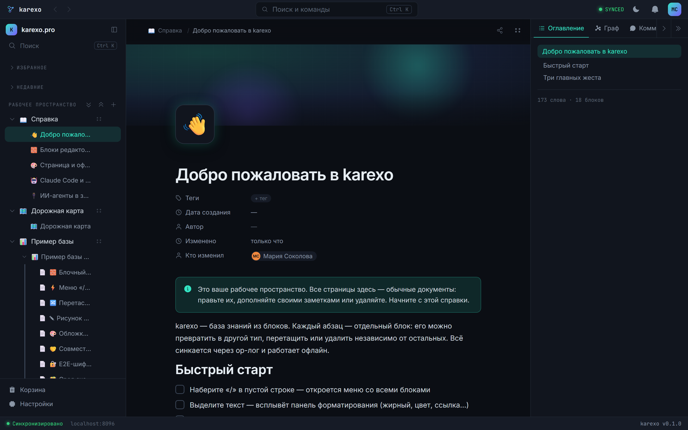
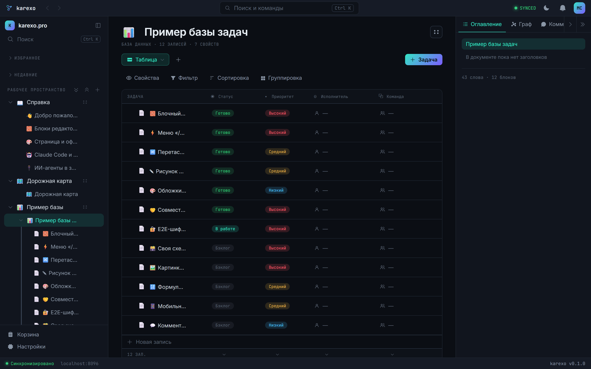
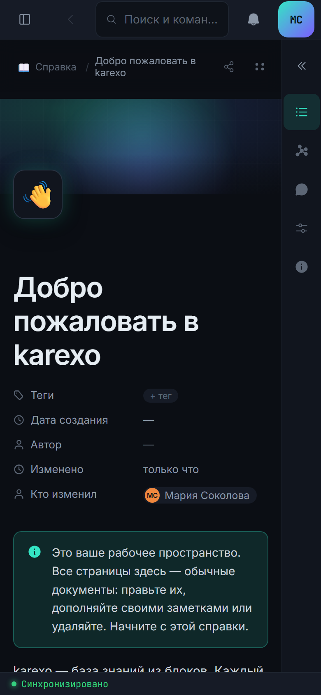
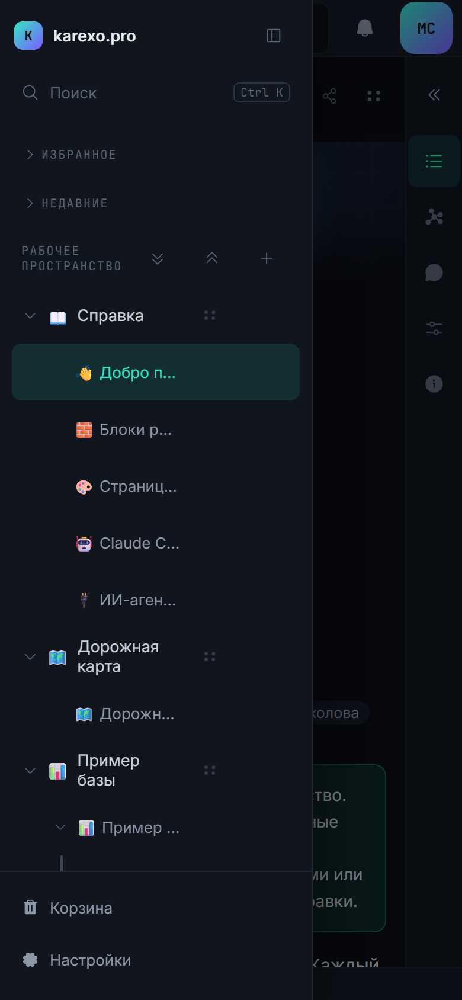
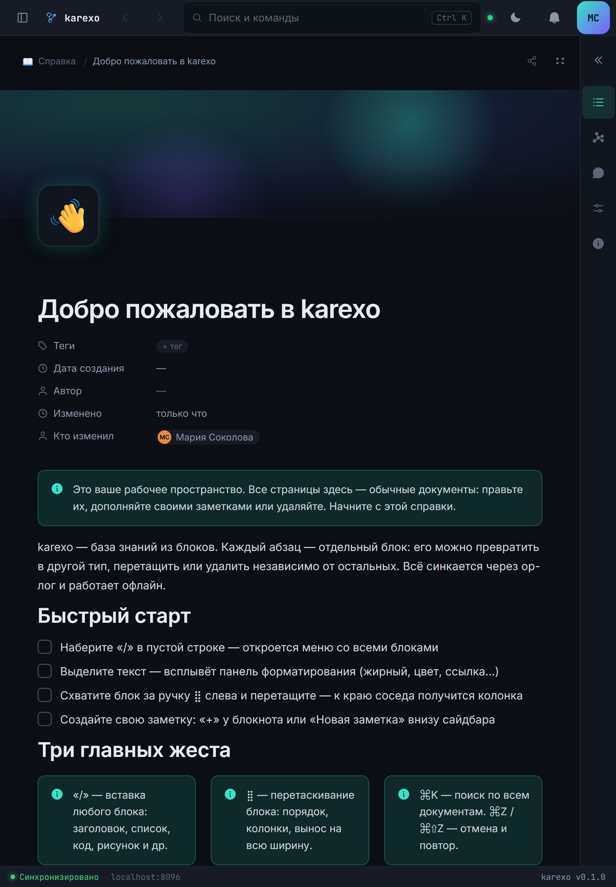

# karexo

**Самохостируемая база знаний из блоков.** Твои знания. Твой сервер.

karexo - это заметки, документы и базы данных в одном приложении. Вы ставите его на свой сервер
или домашний компьютер: данные лежат в вашем хранилище, аккаунты заводите вы, внешнее облако не
участвует.

Этот репозиторий - публичная часть проекта: **справка, инструкции по установке и релизы**.
Исходный код продукта здесь не публикуется. Последний выпуск сервера - **v0.3.0** (19.11.2026),
[все версии и теги образов](docs/releases/README.md). Приложение для Android выходит отдельной
сборкой со своим номером.



<details>
<summary>📸 Ещё снимки: база данных, телефон, планшет</summary>

**База данных - таблица со статусами, приоритетами и исполнителями**



**Телефон и планшет - тот же интерфейс, раскладка под палец**

| Телефон | Боковая панель | Планшет |
|---|---|---|
|  |  |  |

</details>

---

## 🚀 Быстрый старт

Нужен Docker с плагином Compose (команда `docker compose`) и 1 ГБ памяти.

```bash
curl -fsSLO https://raw.githubusercontent.com/mihazzzold/karexo/main/install/install.sh
sh install.sh
```

Скрипт спросит адрес, порт и почту, сам сгенерирует ключ шифрования, запишет `.env` с правами 600,
поднимет стек и дождётся ответа сервера. Там же он спросит **учётку владельца** - заведёт её сразу,
вход будет по почте и паролю.

⚠️ **На вопрос про владельца надо ответить.** Регистрация по умолчанию `invite`: формы
«Зарегистрироваться» на инстансе нет вовсе, а пригласить первого человека некому - на свежей базе
нет ни одной учётки. Пропустите вопрос - получите поднятый инстанс, в который нечем войти.

<details>
<summary>🛠️ Установка руками: <code>docker compose</code> и владелец одной командой</summary>

```bash
# 1. взять файлы установки
curl -fsSLO https://raw.githubusercontent.com/mihazzzold/karexo/main/install/docker-compose.yml
curl -fsSLO https://raw.githubusercontent.com/mihazzzold/karexo/main/install/.env.example
cp .env.example .env

# 2. сгенерировать ключ шифрования - результат в KAREXO_TOKEN_KEY
openssl rand -hex 32

# 3. запустить
docker compose up -d

# 4. завести владельца - до первого входа
printf '%s\n' 'пароль-не-короче-8' | docker compose exec -T karexo \
    karexo-server -create-owner -data /data -owner-email you@example.org
```

В `.env` обязательны **две строки**: `KAREXO_BASE_URL` (адрес, по которому инстанс будут
открывать) и `KAREXO_TOKEN_KEY` (ключ из пункта 2). Пароль идёт в stdin, а не флагом: аргументы
видны в `ps` и в `docker inspect` любому, у кого есть доступ к докеру. Повторный запуск на непустой
базе ничего не меняет - код возврата 10.

</details>

📖 Подробности - установка на сервер, свой домен, HTTPS, почта, резервные копии, обновление:
[docs/установка.md](docs/установка.md).

### 📱 Поставить karexo как приложение

Отдельная установка не обязательна: karexo ставится прямо из браузера и дальше работает как
обычное приложение - своей иконкой, в своём окне, без адресной строки.

| Устройство | Как поставить |
|---|---|
| **Android** | Chrome → меню (⋮) → «Установить приложение»; либо APK из [выпуска приложения](https://github.com/mihazzzold/karexo/releases/tag/v0.2.2) |
| **Windows, Linux, macOS** | Chrome или Edge → значок установки в адресной строке (или меню → «Установить karexo») |
| **iPhone, iPad** | Safari → «Поделиться» → «На экран "Домой"» |

APK - это оболочка вокруг вашего инстанса: при первом запуске она спрашивает его адрес. Своего
сервера приложение не несёт, поэтому содержимое обновляется вместе с сервером, а само приложение -
своим файлом. Установщика для Windows в выпуске нет: там ставится из браузера, как выше.

На телефоне у поставленного приложения есть два быстрых входа:

- **Быстрая заметка** - долгое нажатие на значок приложения: поле, куда пишут мысль, и выбор
  блокнота. Черновик лежит на устройстве, пока вы его не сохраните.
- **Поделиться в karexo** - из меню «Поделиться» любого другого приложения: текст, ссылка или файл
  уезжают в karexo, останется выбрать, как сохранить (закладка с цитатой, только ссылка, файл) и
  куда.

Оболочка после установки открывается **и без сети** - заметки лежат на устройстве. Синхронизация
догонит, когда связь вернётся.

### Что получится

| Параметр | Значение по умолчанию |
|---|---|
| Адрес интерфейса | `http://localhost:8080` (порт меняется переменной `KAREXO_PORT`) |
| Контейнеров | один - он же отдаёт интерфейс и API |
| Хранилище данных | том Docker `karexo-data` - база и вложения в нём |
| Проверка живости | `GET /healthz` - отвечает статусом и версией |
| HTTPS | по умолчанию нет: `KAREXO_TLS=auto` берёт сертификат у Let's Encrypt сам, `file` - ваш сертификат, за обратным прокси оставьте `off` |

Настройки задаются в файле `.env` рядом с `docker-compose.yml`. Обязательных строк две -
`KAREXO_BASE_URL` и `KAREXO_TOKEN_KEY`, без них контейнер не стартует; остальное имеет разумные
умолчания. Чаще всего меняют:

| Переменная | Зачем | По умолчанию |
|---|---|---|
| `KAREXO_TOKEN_KEY` | ключ шифрования токенов интеграций: `openssl rand -hex 32`. Потеряете - все интеграции подключать заново | обязательна |
| `KAREXO_PORT` | порт на вашем сервере | `8080` |
| `KAREXO_BASE_URL` | публичный адрес инстанса - подставляется в ссылки в письмах | обязательна |
| `KAREXO_REGISTRATION` | кто может завести аккаунт: `invite`, `open`, `closed` | `invite` |
| `KAREXO_SMTP_HOST`, `KAREXO_SMTP_PORT`, `KAREXO_SMTP_USER`, `KAREXO_SMTP_PASS`, `KAREXO_SMTP_FROM` | отправка писем: подтверждение почты, сброс пароля, приглашения | пусто |

Без SMTP письма не уходят: пригласить человека, подтвердить почту и сбросить пароль сам человек не
сможет (адрес за него подтверждает владелец в разделе «Пользователи»), а в журнал попадает только
факт письма. Сами коды печатаются лишь с `KAREXO_MAIL_LOG_SECRETS=1`, которой нет в поставочном
`docker-compose.yml`: это путь для разработки на своей машине, а не для рабочего инстанса.

### Какой тег образа взять

В готовом `docker-compose.yml` стоит `ghcr.io/mihazzzold/karexo:latest` - так проще всего
познакомиться и держать домашнюю установку. Инстансу с рабочими данными лучше вписать **точный
тег** (`:v0.3.0` и другие номера): тогда версия меняется только когда вы сами её меняете, а не при
очередном `docker compose pull`. Как это сделать - в [инструкции по установке](docs/установка.md).

---

## ✨ Возможности

Раздел описывает выпущенную версию. Что появилось в ней - в разделе [0.3.0](CHANGELOG.md)
списка изменений, чего ещё нет - в конце того же списка.

### 📝 Редактор

- Блочный редактор: параграфы, заголовки, маркированные и нумерованные списки, чек-листы,
  сворачиваемые тоглы, цитаты, выноски, код, разделители, колонки.
- Медиа и вставки: картинки, файлы, встраивания, закладки на внешние ссылки, простые таблицы,
  формулы (LaTeX), диаграммы Mermaid, рисунки Excalidraw, кнопки-заготовки. Рисунок и диаграмма
  открываются на весь экран.
- Меню `/` для вставки блока, меню `@` для даты или упоминания человека, `[[…]]` - ссылка на
  другой документ.
- Форматирование текста: жирный, курсив, подчёркнутый, зачёркнутый, код, выделение цветом, ссылки.
- Синхро-блок: один фрагмент, вставленный в нескольких местах, - правка в любом видна во всех.
- Обложка и иконка страницы, свойства страницы, шаблоны, история версий с откатом, корзина.
- Режим вики: под текстом страницы появляется каталог её вложенных страниц.
- Вставка из буфера понимает Markdown и HTML - текст из другого редактора не рассыпается.

### 🗄️ Базы данных

- Девять видов одной базы: **таблица, доска, список, галерея, календарь, таймлайн, диаграммы,
  граф, форма**.
- Типы свойств: текст, список, статус, теги, дата, число, человек, прогресс, ссылка, почта,
  телефон, флажок, файлы, формула, связь с другой базой, обратная связь, rollup, а также служебные
  - создано, кем создано, изменено, кем изменено.
- Фильтры, сортировки, группировка, встроенный вид базы прямо внутри страницы.
- Поиск по всем строкам вида: `Ctrl+F` находит и то, что за пределами прокрученного окна.

### 🔍 Навигация и поиск

- Командная палитра и живой поиск по всем документам с переходом к нужному блоку.
- Поиск идёт **на сервере и по содержимому**: палитра находит страницы по тексту, в том числе
  расшаренные, которых нет на этом устройстве. Видимость в выдаче - по тем же правам, что и
  обычный просмотр.
- Бэклинки - кто ссылается на текущую страницу; граф связей документов; оглавление из заголовков.
- Дерево страниц с блокнотами, теги, недавние документы.

### 📅 Календарь

- Календарь в обе стороны: события внешнего календаря приезжают в настоящую базу karexo (вид
  «Календарь», сверка по UID, пометка отменённых), а правка строки уезжает обратно - в CalDAV или
  Google Calendar, со ссылкой на karexo и подписью автора.
- Повторяющиеся встречи, «весь день», отвязка строки от встречи; у Google Calendar - push вместо
  постоянного опроса.
- Право писать в чужой календарь выдаётся пофамильно, а не всем участникам базы.

### ✨ ИИ-чат

- ИИ живёт в чате, а не в блоках: док открывается справа или снизу, по выбору человека. Пунктов
  «ИИ» в меню `/` больше нет; уже вставленные блоки продолжают работать.
- Разговор помнит страницы и честно говорит, когда страница за спиной изменилась.
- Действия над текстом идут из чата, а ответ кладётся в страницу - с подтверждением, а не молча.
- Модель подключается в «Настройках» → AI: свой ключ провайдера или ключ инстанса (`KAREXO_AI_*`).
  Без ключа раздел не работает.

### 👥 Совместная работа

- Доступ к документу конкретным пользователям или целой группе; роли: чтение, комментирование,
  редактирование.
- Группы пользователей: состав ведёт администратор, а доступ выдаётся группе одной строкой, а не
  перечислением людей.
- Команда (облачная редакция): раздел «Команда» - кто приведён, кто занимает оплаченные места,
  группы и скрытая группа **«Вся команда»**. На своём сервере те же права дают группы, их состав
  ведёт администратор.
- Публичная ссылка на документ: с правом чтения, комментирования или правки, при желании - со
  сроком действия.
- Ссылка отдаёт не только одну страницу: по выбору - её подстраницы (до 200) и связанные страницы,
  а у гостя крошка ведёт по дереву.
- Комментарии к блокам, уведомления в реальном времени, напоминания по дате.
- Уведомления и напоминания: лента и тосты в открытом приложении и на телефоне; push в браузер и на
  Android - когда администратор подключил ключи FCM и VAPID.
- Правки синхронизируются между устройствами: изменения сохраняются локально и уходят на сервер,
  когда есть связь; параллельные правки сливаются без ручного разбора конфликтов.

### 🔐 Приватность и шифрование

- Всё живёт на вашем сервере: база SQLite и вложения - в вашем томе.
- Сквозное шифрование (E2E) - **опция, а не умолчание**: включает администратор переменной
  `KAREXO_FEATURES_E2E=true`. Дальше человек заводит личный сейф с паролем и кодом восстановления:
  содержимое шифруется на устройстве, сервер хранит непрозрачные данные и не может их прочитать.
- Участникам общего документа ключ передаётся в зашифрованном виде - расшифровка происходит
  только у них на устройстве. При включённом сейфе вложения тоже шифруются перед отправкой.
- Регистрация с подтверждением почты, вход по паролю (argon2id), второй фактор, список активных
  сессий с возможностью завершить лишние, вход через провайдера (GitHub, Google, GitLab, Яндекс -
  если администратор завёл ключи).

### 📥 Импорт и экспорт

- Экспорт страницы в **Markdown**, **HTML** и на печать (в том числе в PDF средствами браузера).
- Экспорт всего пространства одним архивом и обратный импорт этого архива - с предупреждением, что
  рисунки, вложения и раскладка в Markdown не переживают.
- Импорт экспортов Notion: страницы `.md` и базы `.csv` с определением типов колонок и
  картинками из архива.
- Импорт отдельного Markdown-файла в выбранный блокнот.

### ⚙️ Администрирование и настройки

- Пользователи инстанса, группы, роли (владелец, администратор, участник), роль по умолчанию для
  новых аккаунтов, журнал действий администратора.
- Квоты на хранилище по пользователю и сводка занятого места.
- Личное оформление: светлая, тёмная и системная тема, акценты, плотность интерфейса, справка по
  горячим клавишам с раскладками macOS и Windows.
- Английский интерфейс: «Настройки» → «Внешний вид» → «Язык интерфейса» или «как в системе».

---

## 📊 Статус проекта

karexo уже пригоден для повседневной работы, но это ранняя версия: интерфейс и набор функций ещё
меняются. Что изменилось в конкретной версии - в [списке изменений](CHANGELOG.md) и в
[релизах](../../releases).

**✅ Уже работает**

- Редактор, страницы, блокноты, теги, бэклинки и граф.
- Базы данных со всеми девятью видами и типами свойств.
- Поиск по содержимому на сервере, включая расшаренные страницы.
- Синхронизация между устройствами, история версий, корзина.
- Совместный доступ, группы, публичные ссылки (в том числе на поддерево со связанными страницами),
  комментарии, уведомления, напоминания.
- ИИ-чат: разговор по странице и правки текста с ответом в документ.
- Календарь в обе стороны: импорт внешнего календаря в базу и запись правок обратно.
- Сквозное шифрование документов и вложений, личный сейф - когда администратор включил E2E.
- Импорт из Notion, экспорт в Markdown, HTML, PDF и архивом.
- Администрирование пользователей, групп, ролей и квот.
- Синхро-блоки и режим вики для страницы.
- Мобильная версия: раскладка под палец, «Быстрая заметка» и «Поделиться в karexo».
- Ставится как приложение (PWA) из браузера и открывается в отдельном окне.
- Работа без сети: оболочка кэшируется, документы и так лежат на устройстве.
- Формулы внутри строки текста, упоминания людей, кнопка-макрос с набором действий.
- Карточка-превью у закладки, отметка «онлайн» у людей.
- Английский интерфейс.

**🚧 В разработке**

Список - то, что открыто в бэклоге продукта; обещанных дат нет.

- Ручной порядок записей в базе, как в Notion: сейчас порядок задаёт сортировка, а без неё - порядок
  создания. Начнут после первых платящих.
- Полный экспорт пространства: рядом с Markdown класть журнал правок. Пока архив честно
  предупреждает о потерях.
- Плагины в исходном смысле - чужой код внутри karexo: пока не начато, ждут ответа, что такое
  плагин и где граница его прав.

**🧊 Заморожено до первых продаж**

- Linux-пакеты (`.deb`/`.rpm`), сборка под macOS, подпись кода и подписанные обновления клиентов:
  PWA закрывает то же самое и стоит дешевле.
- Новые виды баз, блоки редактора и типы свойств - набор зафиксирован.
- Глобальный граф всего пространства, квартал и год в календаре и таймлайне.
- Продвижение английского: словарь полон, дальше - по первому запросу англоязычного человека.
- Запись во внешние календари в облачной редакции; на своём сервере она включена по умолчанию.

**⚠️ Известные ограничения**

- Один файл-вложение - до 25 МиБ, больше не подействует: браузер шифрует вложение целиком в памяти.
  Видео проигрывается с перемоткой, но крупные записи лучше хранить снаружи.
- Данные лежат в SQLite: это один сервер, без кластера. Резервная копия - это копия каталога
  данных.
- Формы «Зарегистрироваться» нет: регистрация `invite`, людей зовут приглашением, аккаунты заводит
  администратор. Открытая регистрация (`open`) на публичном адресе - гонка: владельцем станет тот,
  кто зашёл первым.
- Без SMTP приглашение, подтверждение почты и сброс пароля не работают.
- ИИ работает только с подключённым ключом провайдера, push - только с ключами FCM и VAPID.
- Операции, отправленные на сервер **до** включения E2E, остаются на нём незашифрованными:
  включайте шифрование до того, как заведёте важные записи.
- Без HTTPS браузеры не дают криптографию, а на ней держится сейф: пускают только `https://` и
  `localhost`. Для доступа снаружи включайте `KAREXO_TLS=auto` или ставьте сервер за обратный
  прокси с TLS.
- Команды с оплаченными местами - в облачной редакции. На своём сервере людей, группы и роли ведёт
  администратор инстанса.

---

## 📚 Справка и релизы

| Куда | Зачем |
|---|---|
| [🚀 Установка](docs/установка.md) | установка на сервер, обновление, резервные копии |
| [📚 Справка](docs/README.md) | как работать в karexo: редактор, базы данных, совместная работа |
| [📝 Изменения](CHANGELOG.md) | что нового в каждой версии |
| [📦 Выпуски и версии](docs/releases/README.md) | какие выпуски были, что значит номер, какой тег образа брать |
| [📦 Релизы](../../releases) | выпущенные версии и образы |
| [🐞 Задачи](../../issues) | ошибки и предложения |

---

## 💬 Обратная связь

Нашли ошибку или не хватает возможности - заведите задачу:

- 🐞 [Сообщить об ошибке](../../issues/new?template=bug_report.yml)
- 💡 [Предложить улучшение](../../issues/new?template=feature_request.yml)

Как оформить задачу, чтобы её было легко разобрать, - в [CONTRIBUTING.md](CONTRIBUTING.md).

---

## ⚖️ Лицензия

Содержимое этого репозитория - справка, примеры конфигурации и шаблоны - распространяется по
лицензии [MIT](LICENSE): берите, правьте, используйте у себя, в том числе в коммерческих целях.

Сам karexo - приложение и его исходный код - в этот репозиторий не входит и под эту лицензию
не подпадает: продукт поставляется готовым образом, условия его использования определяются
отдельно.
