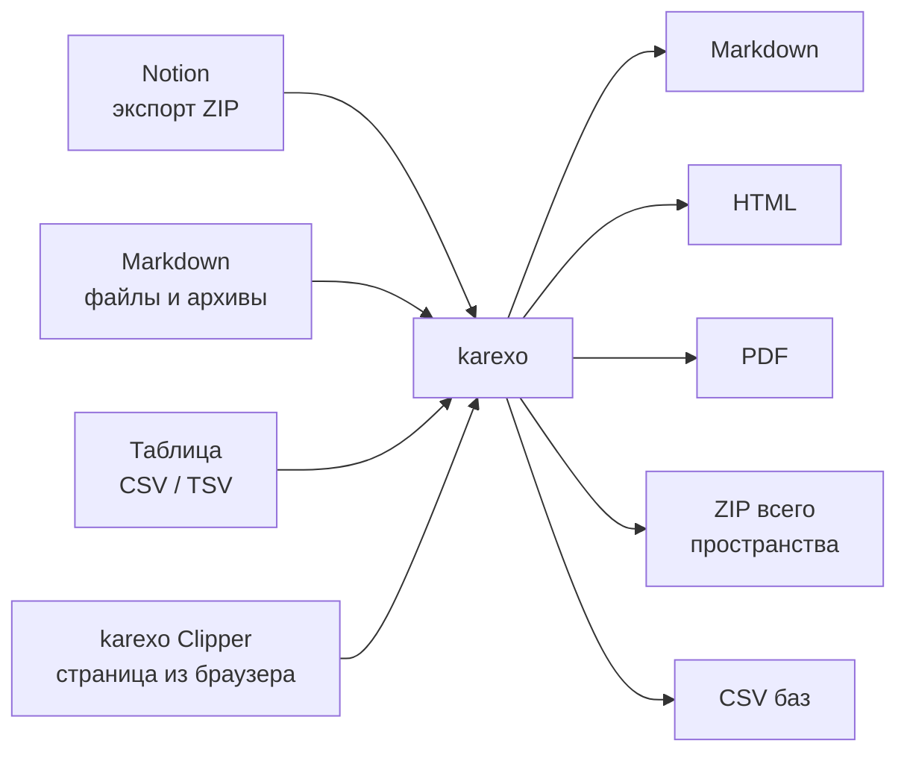

# 📦 Импорт и экспорт

Ваши заметки должны оставаться вашими - и когда вы приходите в karexo, и когда уходите.
Всё, что здесь описано, работает без плагинов и без «премиума».

## 📥 Импорт

Импорт запускается из боковой панели: кнопка `+` рядом с заголовком дерева или правый клик по
блокноту → **«Импортировать…»**. Страницы попадут в тот блокнот, из меню которого вы начали.

Принимаются файлы `.md`, `.markdown`, `.txt`, `.zip`, а также `.csv` и `.tsv` - таблица
становится базой данных.

### 📄 Один markdown-файл

Файл становится одной страницей. Заголовок берётся из имени файла, содержимое разбирается в
блоки: заголовки, списки, чек-листы, цитаты, разделители, блоки кода с языком, формулы
`$$…$$`, диаграммы ` ```mermaid ` и картинки ``. Жирный, курсив, `код` и ссылки внутри
строк сохраняются.

> ℹ️ Markdown-таблицы (GFM) переносятся настоящим блоком-таблицей - с шапкой, выравниванием и
> форматированием внутри ячеек.

### 📊 Таблица `.csv` или `.tsv`

Отдельный файл из Excel, Google Таблиц или другой системы становится **базой данных**: первая
колонка - заголовок записи, остальные - свойства с угаданным по значениям типом. Кодировка
определяется сама (UTF-8, а для старых файлов Excel - windows-1251), поэтому кириллица не
превращается в ромбики.

### 🗜️ ZIP-архив

Архив распознаётся по содержимому, а не по расширению, поэтому неважно, как файл назван.

| Что за архив | Что получится |
|---|---|
| **Ваш архив karexo** (выгружен «Экспортом данных») | Восстанавливается не только текст, но и структура: дерево страниц, блокноты, иконки, обложки, избранное, теги, настройки страниц и порядок. Плюс то, чего в markdown нет: базы со схемой, видами, значениями и связями, форматирование с цветом, ссылки внутрь архива |
| **Чужой архив с markdown-файлами** | Файлы из корня становятся страницами в выбранном блокноте, файлы из подпапок - вложенными страницами |
| **Резервная копия инстанса** (`karexo.db` + `blobs/`) | Это не архив заметок: karexo распознаёт её и объясняет, что такую копию восстанавливают на сервере, а не ввозом |

Повторный импорт того же архива ничего не перетирает: создаётся вторая независимая копия
страниц. Единственное, что переиспользуется, - блокнот с тем же названием.

В отчёте после ввоза karexo честно называет потери: у каких страниц точная копия не прочитана
(срез новее или повреждён - тогда страница приехала из markdown), сколько ссылок на страницы вне
архива убрано и у скольких вложений приехала только ссылка.

### 🧱 Экспорт Notion

Архив Notion распознаётся автоматически - выбирайте тот же zip, который вам отдал Notion
(в том числе «двойной», где внутри лежат части `ExportBlock-…-Part-N.zip`).

| Что в архиве Notion | Куда попадёт |
|---|---|
| Страницы (`.md`) | Обычные страницы karexo; вложенность по подпапкам сохраняется |
| Базы данных (`.csv`) | Базы данных karexo: первая колонка становится заголовком записи, типы остальных колонок определяются по значениям |
| Картинки | Переносятся вложением в оригинале - с разрешением и именем файла |
| Прочие вложения (PDF, видео, документы) | Тоже переносятся вложением: они догружаются очередью, пока открыта вкладка |

Хвост из 32 шестнадцатеричных символов, который Notion добавляет к именам, срезается из
заголовков автоматически.

По окончании karexo показывает отчёт: сколько страниц, баз, записей, картинок и файлов
перенесено, сколько ждёт сети и что не переехало. Если этот же архив уже ввозили, karexo
спросит об этом до начала - повторный ввоз задвоит страницы.

## 🔖 Клиппер - страница из браузера

Расширение **karexo Clipper** (Chrome и Edge) сохраняет открытую страницу или выделение
**новой страницей в вашем karexo** - без копирования вручную.

- Значок → страница или выделение → markdown → новая страница в выбранном блокноте, с тегом.
- Контент отбирается в три уровня: правило домена → Mozilla Readability (тот же движок, что в
  режиме чтения Firefox) → свой экстрактор. Переносится всё содержимое, а не только текст;
  картинки встраиваются в заметку, поэтому она читается и без исходного сайта.
- Ходит расширение **только на адрес вашего инстанса**; логин и пароль хранятся локально, на
  сторонние серверы ничего не уходит.

## 📤 Экспорт

### Одна страница

Меню `⋯` в верхней панели:

| Формат | Что это | Особенности |
|---|---|---|
| **Markdown** | Файл `.md`, а если на странице есть вложения - `.zip` с папкой `files/` | Заголовки, списки, чек-листы, код с языком, таблицы, ссылки, картинки, формулы, диаграммы Mermaid в ` ```mermaid ` |
| **HTML** | Один автономный файл со встроенными стилями | Сохраняет всё, включая подчёркивание, выделение маркером и цвета текста и фона |
| **PDF** | Открывает диалог печати браузера | Сохраните «в PDF» - постраничные разрывы уже настроены |

Вложения едут вместе со страницей: картинки встраиваются в HTML и PDF, а к markdown
прикладывается папка `files/`. Что уложить не удалось (файл больше предела или нет сети),
останется ссылкой на сервер - karexo скажет, сколько таких.

Что стоит знать про Markdown:

- **подчёркивание, выделение маркером и цвета** формат markdown выразить не умеет - они
  остаются только в HTML-экспорте;
- **упоминания** выгружаются текстом `@Имя`;
- **формулы** - своим же исходником `$…$` и `$$…$$`;
- **рисунки** уезжают картинкой (SVG-превью), встроенное в файл;
- **колонки** разворачиваются в обычную последовательность блоков;
- **кнопка-заготовка** превращается в надпись и цитату с её содержимым;
- **страница-база** экспортируется шапкой со счётчиком записей - сами строки выгружаются
  из базы в CSV (см. ниже).

### Всё пространство

**Настройки → Профиль → Экспорт данных → «Экспорт»**.

Скачивается `karexo-export.zip`. На каждую страницу в нём два файла:

- `<имя>.md` - текст для человека: его прочитает любой markdown-редактор;
- `<имя>.ops.json` - **точная копия** страницы: в ней то, чего markdown не передаёт (базы,
  форматирование с цветом, точные ссылки). Ввоз в karexo возвращает такую страницу как была.

Рядом `workspace.json` - снимок структуры: дерево, блокноты, иконки, обложки, избранное,
теги, настройки страниц и определения свойств.

> ⚠️ **Са́мих файлов и картинок в архиве пространства нет** - вместо них остаётся ссылка на сервер.
> И это не резервная копия инстанса: полная копия - это база целиком, её снимают на сервере и
> восстанавливают там же.

Этот же архив karexo умеет импортировать обратно с полным восстановлением структуры - удобно
и для переезда, и для резервной копии.

> 💡 Делайте такой экспорт периодически, особенно если включено сквозное шифрование: это
> самая простая страховка от забытой парольной фразы.

### База данных

Меню базы → **«Экспорт в CSV»**: все строки базы с человеческими значениями (метки вариантов,
имена людей, даты, результаты формул и итогов). Файл открывается в Excel без проблем с
кириллицей.

## 🔁 Переезд в karexo и из него



Форматы - обычные текстовые файлы. Ни один из них не требует karexo, чтобы быть прочитанным.
